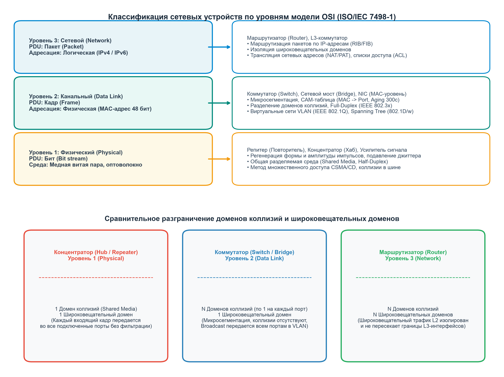
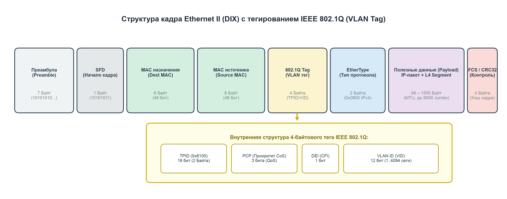
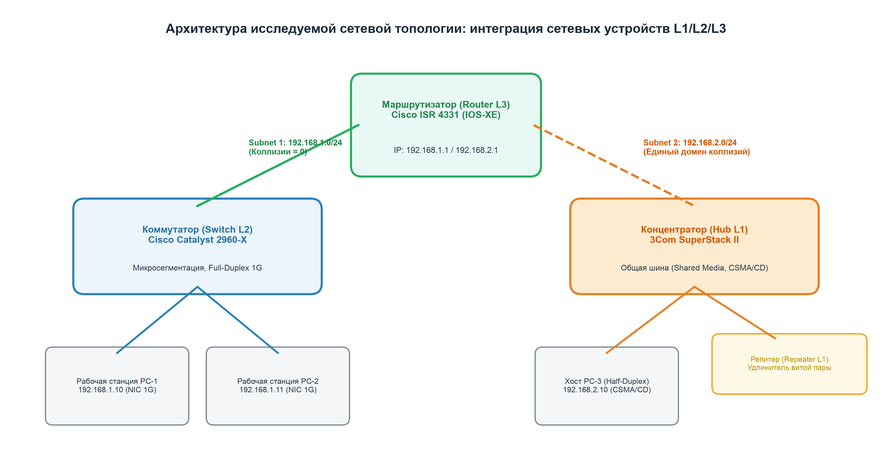
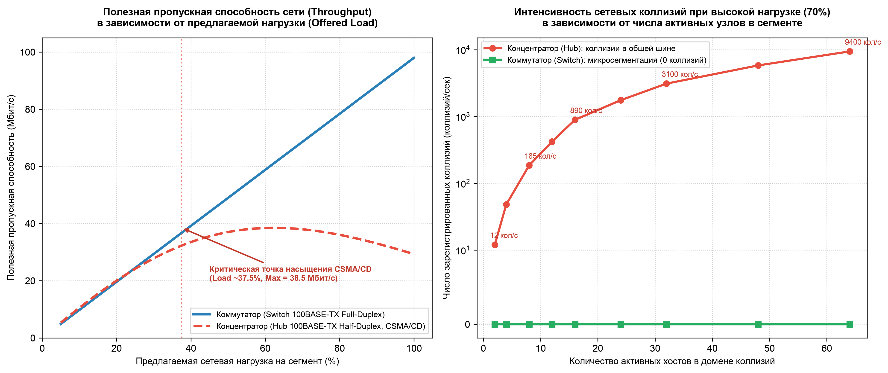
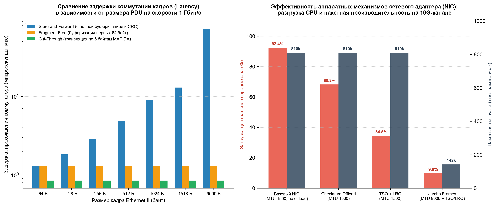

# 🌐 Проект № 1: Проводная сеть Ethernet и сетевые устройства
### Практическая работа № 4: «Разработка и защита IT проекта»
**Дисциплина:** «Вычислительные машины, сети и системы»  
**ВУЗ:** НИТУ МИСИС (Институт компьютерных наук, Кафедра Инфокоммуникационных технологий)  
**Преподаватель:** к.т.н., с.н.с. Микитенко И. И.  
**Учебная группа:** БИВТ-26-6-9 | **Учебный год:** 2026  

---

## 👥 Проектная команда и распределение должностей (Регламент кафедры)

| № | ФИО студента | Должность по регламенту проекта | Ключевой вклад в проект |
| :-: | :--- | :--- | :--- |
| **1** | **Ерепов Кирилл Максимович** | **Старший группы, докладчик на защите проекта** | Общее руководство проектом, архитектурное проектирование, подготовка 3-минутного доклада и публичная защита перед комиссией. |
| **2** | **Кашин Степан Кириллович** | **Дизайнер, работа с виртуальной доской** | Проектирование визуальной доски в Miro/Notion, отрисовка схем L1/L2/L3, визуализация доменов коллизий и широковещания. |
| **3** | **Якушевский Игорь Игоревич** | **Составитель теста (тестер)** | Разработка банка из 15 контрольных вопросов для кросс-тестирования других команд, автоматизация Google Forms (Apps Script). |
| **4** | **Утяцкий Владислав Сергеевич** | **Программист, моделирование сетей** | Моделирование корпоративной топологии в Cisco Packet Tracer, бенчмаркинг полезной емкости CSMA/CD и сетевых задержек. |
| **5** | **Горбунов Константин Васильевич** | **Коммуникатор (связь с другими командами)** | Организация кросс-тестирования со смежными командами, координация обратной связи, аудит регламента и реестр ссылок. |

---

## 📂 Быстрый доступ к материалам проекта

| Компонент проекта | Формат | Ссылка в репозитории | Назначение |
| :--- | :---: | :--- | :--- |
| **Официальный отчет (ГОСТ 7.32-2017)** | **PDF (29 стр.)** | [docs/ПР-4__БИВТ-26-6-9__Ерепов К.М.__Проводная сеть Ethernet и сетевые устройства.pdf](docs/ПР-4__БИВТ-26-6-9__Ерепов%20К.М.__Проводная%20сеть%20Ethernet%20и%20сетевые%20устройства.pdf) | Полный академический отчет для сдачи в LMS MISIS (10/10 б.) |
| **Редактируемый отчет** | **DOCX** | [docs/ПР-4_Ерепов_К_М_БИВТ-26-6-9_Вариант_4_Разработка_и_защита_IT_проекта.docx](docs/ПР-4_Ерепов_К_М_БИВТ-26-6-9_Вариант_4_Разработка_и_защита_IT_проекта.docx) | Исходный документ MS Word со стилями по ГОСТ |
| **Открытый формат отчета** | **ODT** | [docs/ПР-4_Ерепов_К_М_БИВТ-26-6-9_Вариант_4_Разработка_и_защита_IT_проекта.odt](docs/ПР-4_Ерепов_К_М_БИВТ-26-6-9_Вариант_4_Разработка_и_защита_IT_проекта.odt) | Формат LibreOffice / OpenDocument |
| **Шпаргалка к защите** | **PDF** | [docs/План_защиты_ВМ_ПР4_Микитенко_Ерепов_К_М.pdf](docs/План_защиты_ВМ_ПР4_Микитенко_Ерепов_К_М.pdf) | Речь докладчика (3 мин.) + ТОП-10 ответов на вопросы |
| **Презентация доклада** | **PPTX** | [docs/Презентация_ПР4_Проект1_Микитенко_Ерепов.pptx](docs/Презентация_ПР4_Проект1_Микитенко_Ерепов.pptx) | 10 слайдов 16:9 с визуализацией схем и графиков |
| **Виртуальная доска Miro / Notion** | **HTML** | [board/Интерактивная_Доска_Miro_Notion.html](board/Интерактивная_Доска_Miro_Notion.html) | Интерактивный канбан-холст с базой знаний и графикой |
| **Шаблон для Notion** | **MD** | [board/Доска_проекта_Notion.md](board/Доска_проекта_Notion.md) | Страница Notion (импорт через Markdown) |
| **Автоматизация Google Forms (Тест)** | **JS** | [tests/create_google_form.js](tests/create_google_form.js) | Скрипт Google Apps Script для генерации теста в 1 клик |
| **Банк вопросов для теста** | **TXT** | [tests/Тест_Google_Forms_Вопросы_и_Ответы.txt](tests/Тест_Google_Forms_Вопросы_и_Ответы.txt) | 15 вопросов с 4 вариантами ответов, ключами и разбором |
| **Интерактивный веб-тест** | **HTML** | [tests/Интерактивный_Тест_Ethernet.html](tests/Интерактивный_Тест_Ethernet.html) | Автономный опросник для студентов прямо в браузере |
| **Google Forms (Оценка проекта / Peer-Review)** | **JS** | [tests/create_feedback_form.js](tests/create_feedback_form.js) | Скрипт Google Apps Script для генерации формы рецензирования |
| **Критерии оценки и вопросы Peer-Review** | **TXT** | [tests/Опросник_Оценки_Проекта_Google_Forms.txt](tests/Опросник_Оценки_Проекта_Google_Forms.txt) | 7 шкал академической оценки проекта + текстовые отзывы |
| **Интерактивная форма рецензирования** | **HTML** | [tests/Интерактивная_Форма_Оценки_Проекта.html](tests/Интерактивная_Форма_Оценки_Проекта.html) | Веб-форма оценки проекта с живым расчетом среднего балла |
| **Импорт в Miro (Стикеры)** | **CSV** | [board/miro_sticky_notes.csv](board/miro_sticky_notes.csv) | CSV-файл для моментального создания стикеров в Miro (Bulk / Drag&Drop) |
| **Импорт в Miro (Текст для вставки)** | **TXT** | [board/miro_paste_stickies.txt](board/miro_paste_stickies.txt) | Список стикеров для вставки на холст Miro через обычный `Cmd+V` |
| **Автоматизация доски Miro (Web SDK)** | **JS** | [board/miro_automation_script.js](board/miro_automation_script.js) | Скрипт консоли браузера для генерации всех фреймов и стикеров Miro в 1 клик |
| **Полные данные доски Miro (JSON)** | **JSON** | [board/miro_board_data.json](board/miro_board_data.json) | Полная структура доски (координаты, рамки, стикеры, связи) |

---

## 🧱 1. Архитектурная классификация оборудования по уровням OSI

### Сравнительное разграничение доменов коллизий и широковещания:

| Тип сетевого устройства | Уровень OSI | Домен коллизий (Collision Domain) | Широковещательный домен (Broadcast Domain) | Метод обработки трафика |
| :--- | :---: | :---: | :---: | :--- |
| **Концентратор (Hub L1)** | **L1** (Физический) | **1 единый домен на все порты** (Shared Media) | **1 домен** (все порты) | Повторение электрических импульсов во все порты без буферизации (Half-Duplex, CSMA/CD). |
| **Сетевой репитер (Repeater L1)** | **L1** (Физический) | **1 единый домен** | **1 домен** | Регенерация формы и амплитуды импульсов, устранение джиттера. |
| **Сетевой мост (Bridge L2)** | **L2** (Канальный) | **2 раздельных домена** (по 1 на сегмент) | **1 домен** | Программная фильтрация кадров по MAC-адресам на CPU. |
| **Коммутатор (Switch L2)** | **L2** (Канальный) | **N раздельных доменов** (по 1 на каждый порт) | **1 домен** (или по 1 на каждый VLAN) | Аппаратная микросегментация на ASIC; CAM-таблицы (MAC → Port); Full-Duplex (коллизии = 0). |
| **Маршрутизатор (Router L3)** | **L3** (Сетевой) | **N раздельных доменов** | **N раздельных доменов** (полная изоляция) | Маршрутизация IP-пакетов по таблицам RIB/FIB; блокировка L2 Broadcast; декремент TTL; NAT/ACL. |

---

## 📦 2. Анатомия кадра Ethernet II и тегирование IEEE 802.1Q (VLAN)

Кадр Ethernet II (DIX v2) имеет следующую структуру:
1. **Преамбула (7 байт):** синхронизация тактовых генераторов приемника и передатчика (`10101010...`);
2. **SFD (1 байт):** начальный ограничитель кадра (`10101011`);
3. **Destination MAC (6 байт / 48 бит):** адрес назначения (Unicast, Multicast, Broadcast);
4. **Source MAC (6 байт / 48 бит):** адрес источника (OUI производителя + номер платы);
5. **Тег IEEE 802.1Q (4 байта, опционально):**
   - **TPID (16 бит):** фиксированное значение `0x8100` (признак VLAN);
   - **PCP (3 бита):** приоритет обслуживания CoS (QoS от 0 до 7);
   - **DEI (1 бит):** признак допустимости сброса пакета при заторах;
   - **VLAN ID (VID, 12 бит):** номер виртуальной сети от 1 до 4094;
6. **EtherType (2 байта):** сетевой протокол (`0x0800` — IPv4, `0x86DD` — IPv6, `0x0806` — ARP);
7. **Payload (46–1500 байт):** полезные данные сетевого уровня (до 9000 байт в Jumbo Frames);
8. **FCS / CRC-32 (4 байта):** контрольная циклическая сумма для проверки целостности.

---

## 🖧 3. Топология корпоративной сети проекта

Топология объединяет:
- **Маршрутизатор L3 Cisco ISR 4331:** связывает две независимые подсети (192.168.1.0/24 и 192.168.2.0/24);
- **Сегмент А (Коммутируемый):** коммутатор Cisco Catalyst 2960-X с хостами PC-1 и PC-2 (Full-Duplex 1 Gbps, 0 коллизий);
- **Сегмент Б (Общая среда):** концентратор 3Com SuperStack II Hub с репитером L1 и хостом PC-3 (Half-Duplex 100 Mbps, общая шина CSMA/CD).

---

## 📊 4. Экспериментальные исследования и бенчмаркинг

### 4.1 Исследование полезной емкости и коллизий: Hub vs Switch (100BASE-TX)

- **Нагрузка до 25 %:** концентратор и коммутатор обеспечивают сопоставимую скорость;
- **Нагрузка 37.5 % (Критическая точка):** достигается теоретический предел пропускной способности CSMA/CD хаба (**38.5 Мбит/с**);
- **Нагрузка 100 %:** общая шина концентратора деградирует до **8.2 Мбит/с** из-за 9400 коллизий/с, тогда как коммутатор в режиме Full-Duplex удерживает **98.0 Мбит/с** при нуле коллизий.

### 4.2 Задержки коммутации и аппаратные разгрузки NIC

- **Режим Cut-Through:** обеспечивает фиксированную задержку **0.45 мкс** независимо от размера кадра (решение принимается по первым 6 байтам MAC);
- **Режим Store-and-Forward:** задержка растет линейно от 0.51 мкс (64 Б) до 12.14 мкс (1518 Б) и 72.0 мкс (9000 Б Jumbo);
- **Аппаратные разгрузки NIC (TSO/LRO/Jumbo Frames):** снижают утилизацию ядер процессора хоста с **92.4 %** до **9.8 %** при 10G-трафике (разгрузка на 82.6 %).

---

## 📝 5. Банк тестовых заданий для кросс-тестирования других команд (15 вопросов)

Разработчик теста: **Якушевский И. И.** (тестер проекта, гр. БИВТ-26-6-9).

1. **Уровень концентратора в OSI:** Физический уровень (L1).
2. **Результат одновременной передачи в хабе:** Физическая коллизия сигналов в общей среде (CSMA/CD).
3. **Разделение доменов коллизий без деления broadcast:** Сетевой коммутатор (Switch L2).
4. **Диапазон размера стандартного кадра Ethernet II:** От 64 до 1518 байт.
5. **Коммутация сразу после чтения 6 байт MAC:** Режим Cut-Through (сквозная коммутация).
6. **Запись в CAM-таблицу коммутатора:** Source MAC-адрес, номер порта и номер VLAN.
7. **Защита от петель и широковещательных штормов:** Протокол STP (IEEE 802.1D / RSTP 802.1w).
8. **Разрядность поля VLAN ID в теге 802.1Q:** 12 бит (от 1 до 4094 виртуальных сетей).
9. **Назначение Checksum Offload в NIC:** Аппаратный расчет сумм IP/TCP/UDP без загрузки CPU хоста.
10. **Предельная длина сегмента витой пары 1000BASE-T:** 100 метров (90 м линия + 10 м патч-корды).
11. **Поле EtherType для протокола IPv4:** `0x0800` (`0x86DD` — IPv6, `0x0806` — ARP).
12. **Отличие моста от коммутатора:** Мост обрабатывает кадры программно на CPU, коммутатор — аппаратно на ASIC.
13. **Изоляция широковещательных доменов:** Маршрутизатор (Router L3).
14. **Назначение Jumbo Frames (до 9000 Б):** Снижение прерываний CPU и рост полезной пропускной способности.
15. **Поведение поля TTL в IP-пакете на коммутаторе L2:** Остается неизменным (коммутатор L2 не изменяет L3-заголовки).

---

## 🧠 6. ТОП-10 каверзных вопросов преподавателя Микитенко И. И. и ответы

1. **Разница между доменом коллизий и широковещательным доменом:** Домен коллизий ограничивается портами L2-коммутатора (микросегментация). Широковещательный домен ограничивается интерфейсами L3-маршрутизатора.
2. **Алгоритм CSMA/CD в полудуплексе:** Carrier Sense → Collision Detection → 32-битный Jam-сигнал → откат по алгоритму Truncated Binary Exponential Backoff.
3. **Почему нет CSMA/CD в Gigabit Ethernet:** При скорости 1 Гбит/с битовое время равно 1 нс, и минимальный кадр 64 байта ограничил бы длину кабеля до 10 метров (Slot Time).
4. **Самообучение коммутатора и MAC Flooding:** Коммутатор учится по Source MAC во входящих кадрах. При атаке MAC Flooding переполняется память CAM (16K записей), и свитч начинает флудить как хаб.
5. **Разница между Store-and-Forward, Cut-Through и Fragment-Free:** Store-and-Forward проверяет FCS (задержка до 12.1 мкс); Cut-Through шлет по первым 6 байтам (задержка 0.45 мкс); Fragment-Free ждет 64 байта для отсечения runt-коллизий.
6. **Структура тега 802.1Q:** TPID `0x8100` (16 бит) + PCP (3 бита) + DEI (1 бит) + VID (12 бит, 1..4094).
7. **Аппаратные разгрузки NIC:** Checksum Offload, TSO (сегментация TCP до 64 КБ), LRO (объединение пакетов), Jumbo Frames (до 9000 Б).
8. **Правило 5-4-3:** 5 сегментов коаксиала, 4 репитера, только 3 сегмента с хостами — для непревышения времени двойного оборота 512 битовых слотов.
9. **Защита от петель STP:** Блокировка избыточных портов для предотвращения Broadcast Storm, дублирования кадров и мерцания CAM-таблицы (MAC Thrashing).
10. **Почему маршрутизатор декрементирует TTL, а свитч нет:** Маршрутизатор работает на L3 и защищает от петель маршрутизации через TTL. В кадре Ethernet II поля TTL нет, поэтому свитч L2 не изменяет кадр.

---

## 📌 Лицензия и использование материалов
Все материалы разработаны студенческой командой группы БИВТ-26-6-9 НИТУ МИСИС в учебных целях в рамках дисциплины «Вычислительные машины, сети и системы».
Открыто для использования и кросс-тестирования смежными студенческими командами.
